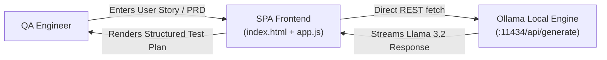

# 📝 Local Test Case Generator

> **AI-powered test case generation from User Stories & PRDs running 100% locally with Ollama (Llama 3.2) and the B.L.A.S.T. Protocol.**

[](https://ollama.com)
[](https://developer.mozilla.org)
[](#)

---

## 🌟 Overview

The **Local Test Case Generator** is a privacy-first web application designed for QA engineers and SDETs. It allows teams to generate comprehensive, production-ready manual and automated test scenarios directly from user stories and requirements without sending proprietary data or IP to external cloud LLM providers.

### Key Capabilities
- **Local AI Inference**: Powered by local `llama3.2` model via Ollama REST API.
- **B.L.A.S.T. Protocol**: Structured prompt system ensuring High Coverage, Anti-Hallucination boundaries, and standard Gherkin/Tabular test formats.
- **Zero Cloud Leakage**: All processing happens strictly on `localhost`.
- **Export & Copy**: Instant clipboard copying and markdown export of generated test cases.

---

## 🏗️ Architecture



---

## 🚀 Getting Started

### 1. Prerequisites
- [Ollama](https://ollama.com/) installed and running.
- Pull the Llama 3.2 model:
  ```bash
  ollama pull llama3.2
  ```

### 2. Configure CORS for Local Browser Requests
Start Ollama with cross-origin requests allowed:
```powershell
# Windows PowerShell
$env:OLLAMA_ORIGINS="*"
ollama serve
```
*(Or run `tools/restart_ollama_cors.ps1`)*

### 3. Launch the Application
Open `frontend/index.html` in your browser or serve it using Node.js / Python:
```bash
# Using Node server
cd frontend
node server.js

# Or using Python
python -m http.server 3000
```
Open `http://localhost:3000` in your web browser.

---

## 📁 Project Structure

```
LocalTestCaseGenerator/
├── architecture/          # Architecture blueprints & flow designs
├── frontend/
│   ├── app.js             # Client-side LLM orchestration & UI state
│   ├── index.html         # Modern responsive test case generation UI
│   ├── server.js          # Lightweight local static server
│   └── style.css          # Clean dark/light theme styling
├── tools/
│   ├── check_ollama.ps1       # Healthcheck utility for Ollama daemon
│   ├── restart_ollama_cors.ps1 # CORS configuration helper
│   ├── run_ollama.ps1         # One-click Ollama launcher
│   └── verify_ollama.py       # Python verification script
└── BLAST.md               # B.L.A.S.T. Framework documentation
```
